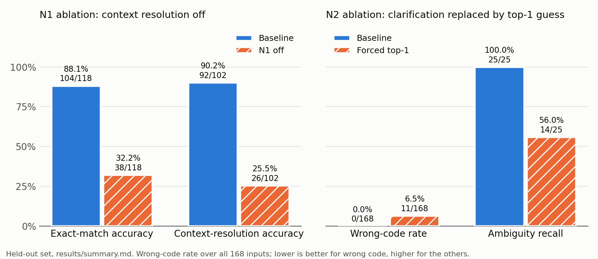

# Parsley: A Context-Aware, Self-Verifying English-to-MiniLang Compiler

Final project report. Team: Ashwin Lakshminarasimhan, Aditya Kishor, Maheep Singh.

All results in this report come from `results/summary.md`, produced by
`python -m parsley.eval.run_eval` on the frozen held-out data in `tests/eval_data/`. The run
is deterministic, and the summary records the SHA-256 digest of every data file used.

## 1. Abstract

Parsley compiles constrained English sentences into MiniLang, a small imperative language
with numbers, strings, `IF` and `REPEAT`. Many systems already translate English into code or into
domain-specific languages. This project studies a particular combination of three ideas inside a formally specified language. First, the
compiler's symbol table feeds back into how English is read (N1). Second, the front end
keeps several ranked readings and asks a targeted question instead of guessing (N2).
Third, every accepted statement is checked three ways: back-translated into canonical
English, re-parsed and compared with the intended syntax tree, and run by two independent
evaluators (N3). A "did you mean" component suggests supported phrasings for rejected
input (N4), and a measured evaluation with ablations supplies the evidence (N5).

The system is rule-based, deterministic and uses only the Python standard library. On a
frozen held-out set of 168 inputs, it produced exact-match MiniLang for 104 of 118 inputs
that have gold code (88.1%), wrote no wrong code, asked no unnecessary questions and
rejected all 25 unsupported inputs safely. Turning context resolution off lowered exact
match to 38/118 (32.2%). Replacing clarification with a forced top-1 guess raised wrong
code from 0 to 11 of 168 inputs. The verifier caught all 188 injected code-generation bugs
(V2 188/188, V3 173/188). The evaluation also found weak points: paraphrase consistency is
1/15 groups, N4 suggestions were useful for 0 of 13 rejected paraphrases, and V3 caught
nothing that V2 missed on this mutation set.

**Keywords:** natural-language programming, semantic parsing, clarification questions,
compiler symbol table, back-translation, differential testing, ablation.

## 2. Introduction and problem statement

People describe small programs in English all the time: "make a variable called score and
set it to 10", then "add 5 to it". Turning such sentences into code raises two problems
that a plain pattern matcher handles badly. The first is reference: "it" and bare words
such as `score` mean different things depending on what the program has declared so far.
The second is trust: when a translator silently picks one reading of an ambiguous
sentence, the user gets code that runs but does the wrong thing, and nothing in the output
says so.

General NL-to-code systems usually answer both problems with a larger model. Parsley takes
the opposite route. MiniLang is fixed and small, the English it accepts is specified
pattern by pattern, and every stage returns either a testable result or a diagnostic. In
that setting the compiler already knows things a language model has to guess, such as
which names exist, their types, and which variable was used last. The project asks whether
feeding that knowledge back into interpretation, asking instead of guessing, and checking
each output in several independent ways measurably improves translation, and where it
does not.

**Objectives.**

1. Translate one English sentence at a time into canonical MiniLang inside a session.
2. Use compiler state (symbol table, reference stack) to resolve pronouns, variable versus
   text, typos and implicit declarations (N1).
3. Accept, clarify or reject each sentence by an explicit rule, with templated questions
   (N2).
4. Verify each accepted statement by back-translation (V1), structural round-trip (V2) and
   execution equivalence (V3) (N3).
5. Suggest a supported phrasing for rejected input (N4).
6. Measure all of this on held-out data, with ablations and mutation tests (N5).

**Organisation.** Section 3 places the work among related systems. Sections 4 to 6
describe the architecture, the language and the implementation. Section 7 states the
novelty claims, Section 8 reports the evaluation, Section 9 lists the limitations, Section
10 records who built what, and Section 11 concludes.

## 3. Related work

The five works below were chosen in Phase 1 (NOVELTY.md) and their bibliographic details
were checked against OpenAlex records for each DOI before this report was written.

**NL to domain-specific languages.** Desai et al. [1] map English into programs in a
domain-specific language by ranking a set of candidate programs. Parsley shares the idea
of ranked candidates over a small target language. It differs in what happens after
ranking: the symbol table re-scores and resolves candidates, close readings trigger a
question rather than a choice, and the chosen program is verified.

**NL to general-purpose code.** Austin et al. [2] benchmark large language models on short
Python tasks and check them by running test cases. That work sits at the neural,
open-ended end of the field. Parsley is deterministic and constrained, and it uses
execution (V3) as a self-check on its own output, not as a benchmark oracle.

**Clarification in semantic parsing.** Yao et al. [3] build a parser that asks the user
questions when it is uncertain, with text-to-SQL as the case study. Parsley's N2 follows
the same principle, but its uncertainty signals include compiler facts (declared names,
types, edit distance to a declared name) and not only model confidence. Li et al. [4] show
that under-specified descriptions of Python code can be resolved by asking clarification
questions before generating code. Parsley applies the idea to a formal mini-language with
slot-targeted questions and measures the unnecessary-question rate.

**Context across utterances.** Suhr et al. [5] interpret each sentence of an interaction
using its history. Parsley's N1 also uses history, but through an explicit compiler data
structure, the symbol table and reference stack, with deterministic rules that an
ablation can switch off.

None of these works combines symbol-table feedback, explicit three-way decisions and
layered verification of the output in one pipeline over a formally specified language,
and that combination is what this project claims.

## 4. System architecture

Figure 1 shows the pipeline. Each English sentence passes through stages [A] to [H]; the
arrows going up are the feedback paths that make N1 work.

```
 English sentence
       |
 [A] Normalizer ............ keywords matched in lowercase; identifier case kept
       |
 [B] Candidate generator ... pattern rules -> 0..k candidate intents, each with slots + score
       |            ^
       |            |  [N1] Context resolver: symbol table + reference stack
       |            |       (variable vs string, 'it', typos, implicit declare)
       v            |
 [C] Ambiguity gate [N2] -- accept --> continue
       |         \-- clarify --> ask user / emit diagnostic --> re-enter at [B]
       |          \-- reject  --> [N4] nearest-pattern suggestion
       v
 [D] IR / AST builder (typed nodes)
       |
 [E] Semantic analyzer + symbol table  ----------------------------^ (feeds N1)
       |
 [F] Code generator (AST -> MiniLang text)
       |
 [G] Verifier [N3]:  V1 back-translation | V2 re-parse + AST compare | V3 execution equivalence
       |
 [H] Trace / output:  input, normalized text, candidates + scores, decision,
                      AST, checks, back-translation, MiniLang, verification result
```

*Figure 1. The Parsley pipeline (from ARCHITECTURE.md).*

**Data contracts.** Every cross-stage payload is a frozen dataclass defined once in
ARCHITECTURE.md Section 2: `Candidate` (intent, slots, score, rule id, notes), `NLPResult`
(status `ok`, `ambiguous` or `unsupported`, ranked candidates, question, suggestion, reason
codes), `Diagnostic` (level, stage, code, message), `Verification` (back-translation, V2
and V3 results, details), `Session` (symbol table, reference stack, history) and the AST
nodes. A change to a contract goes through a written protocol: edit the contract first,
get the affected owners' approval, then change code and tests.

**Design rules.** No stage silently guesses; it returns a testable result or a diagnostic.
The NLP never emits MiniLang text; only the code generator writes code. The symbol table
has one writer, the semantic analyzer; the context resolver only reads it. The AST
evaluator and the interpreter share no evaluation code, and the interpreter runs on parsed
MiniLang rather than the original AST, so V3 compares two different paths.
Mutation and corruption hooks exist only under `tests/`.

**Pipeline result.** `run(text, session)` returns a `PipelineResult` with status `ok`,
`needs_clarification`, `unsupported` or `error`; MiniLang and back-translation for `ok`;
the question and options for a clarification; reason codes and an optional suggestion for
`unsupported`; diagnostics; the verification record; and a full trace. `answer(result,
reply, session)` merges the user's reply to a question and runs the sentence again.

## 5. MiniLang specification

### 5.1 Grammar

```
program      := statement*
statement    := declaration | assignment | print_stmt | if_stmt | repeat_stmt
declaration  := "LET" IDENT "=" expression ";"
assignment   := IDENT "=" expression ";"
print_stmt   := "PRINT" expression ";"
if_stmt      := "IF" condition "THEN" block ("ELSE" block)?
repeat_stmt  := "REPEAT" NUMBER "TIMES" block
block        := "{" statement* "}"
condition    := expression ( ">" | "<" | "==" | ">=" | "<=" | "!=" ) expression
expression   := term   (("+" | "-") term)*
term         := factor (("*" | "/") factor)*
factor       := "-" factor | NUMBER | STRING | IDENT | "(" expression ")"
```

Unary minus binds tightest, then `*` and `/`, then `+` and `-`; binary operators are
left-associative. There are two types, `number` and `string`, with no implicit
conversion. Strings support `+` (concatenation) and `==` / `!=` only. Keywords are reserved
in any case. A `REPEAT` count is an integer literal from 1 to 1000. There is one global
scope, and `LET` inside a block is a semantic error.

The code generator prints one canonical form: one statement per line, single spaces around
operators, keywords in upper case, numbers exactly as written, and parentheses only where
precedence needs them. Semantic errors carry codes `E201` to `E209` (for example `E201`
for a variable used before it is created and `E209` for an assignment that would change a
variable's type) and a redeclaration warning `W208`.

### 5.2 Supported English

Table 1 lists the English patterns. `NAME` is a variable position (an identifier or a
pronoun), `VALUE` a value expression, `COND` a condition, `STMT` a one-statement block body
and `N` a count; `(a|b)` marks alternatives and `[x]` an optional part.

| Intent | Rule | Pattern | Example | MiniLang |
|---|---|---|---|---|
| declare | D1 | `(make\|create\|declare) a [new] variable (called\|named) NAME and set it to VALUE` | make a variable called age and set it to 20 | `LET age = 20;` |
| declare | D2 | `(make\|create\|declare) a [new] variable (called\|named) NAME (with value\|equal to) VALUE` | create a variable named totalAmount with value 0 | `LET totalAmount = 0;` |
| declare | D3 | `let NAME be VALUE` | let greeting be "Hello" | `LET greeting = "Hello";` |
| assign | S1-S3 | `(set\|change\|update) NAME to [VALUE]` | set age to age plus 1 | `age = age + 1;` |
| assign | S4 | `assign VALUE to NAME` | assign 5 to score | `score = 5;` |
| increment | INC1, INC2 | `(increase\|increment\|raise) NAME [by VALUE]`, `add VALUE to NAME` | add 5 to score | `score = score + 5;` |
| decrement | DEC1, DEC2 | `(decrease\|decrement\|reduce\|lower) NAME [by VALUE]`, `subtract VALUE from NAME` | subtract 3 from lives | `lives = lives - 3;` |
| multiply | MUL1 | `multiply NAME [by VALUE]` | multiply total by 3 | `total = total * 3;` |
| divide | DIV1 | `divide NAME [by VALUE]` | divide total by 2 | `total = total / 2;` |
| print | P1 | `(print\|show\|display) [VALUE]` | display hello world | `PRINT "hello world";` |
| if | IF1, IF2 | `if COND then STMT [else STMT]` | if age is greater than 17 then print adult else print minor | `IF age > 17 THEN { PRINT "adult"; } ELSE { PRINT "minor"; }` |
| repeat | REP1-REP3 | `repeat [N times] STMT`, `repeat STMT N times`, `do STMT N times` | repeat 3 times print hello | `REPEAT 3 TIMES { PRINT "hello"; }` |

*Table 1. Supported English patterns (LANGUAGE_SPEC.md Section 6).*

A bracketed slot is required but may be missing from the sentence; a missing slot leads to
a question, not a rejection, which is how `increase x` produces "By how much should x
increase?". A sentence that joins two statements with `and` is rejected, because a block
holds one statement. Requests outside the language (functions, lists, user input, other
loops, library maths, files, jumps) are rejected with a reason code.

**Accept, clarify, reject.** The gate accepts when exactly one reading remains or the top
score leads the next by at least the margin (`CLARIFY_MARGIN = 0.05`) and no required slot
is missing. It clarifies when readings are too close, a required slot is missing, a word
looks like a typo of a declared name, a pronoun has nothing to refer to, or the scope of an
operator is unclear. It rejects when no pattern matches.

## 6. Implementation

Parsley is a Python package (`src/parsley/`) with no third-party runtime dependencies;
tests use pytest. The modules follow the stages of Figure 1.

**Normalizer (`nlp/normalizer.py`).** Produces a lowercased copy of the sentence for
keyword matching while keeping identifiers and quoted text in their original case,
collapses spaces, strips trailing punctuation and records tokens with their positions.

**Pattern table and candidate generator (`nlp/patterns.py`, `nlp/candidates.py`).** The
templates of Table 1 are compiled into a data-driven pattern table, which is the only place
English phrasings live. The generator matches every rule and returns zero or more scored
`Candidate`s, or `unsupported` with sorted reason codes (`NO_MATCH`,
`REJECT_AND_CONTINUATION`, `EMPTY_INPUT` and others). A scoring hook lets an optional
external scorer change scores only; it is off by default and not part of any result here.

**Context resolver (`nlp/context.py`, N1).** Reads the session's symbol table and reference
stack and resolves each candidate: bare words become variables or text by the
variable-versus-text policy, pronouns take the top of the reference stack, a likely typo of
a declared name is flagged with a length-scaled edit-distance threshold (never on common
English words), an assignment to an undeclared name becomes an implicit declaration with a
`W301` warning, and type hints re-score readings.

**Ambiguity gate (`nlp/ambiguity.py`, N2).** Applies the accept / clarify / reject rule,
builds the question from fixed templates (alternatives, typo, empty-stack pronoun, operator
scope, missing slot, checked in that order) and merges the user's answer back into the
candidate.

**Suggestions (`nlp/suggest.py`, N4).** For a rejected sentence, proposes a supported
phrasing: a fixed rewrite for "store VALUE in NAME", or a correction of a misspelled
command word, ranked by token overlap and normalized edit distance and kept only if the
candidate generator accepts it. For an `and` rejection it returns the first statement and,
separately, a guidance sentence that the pipeline adds to the error message.

**IR builder (`compiler/ast_nodes.py`, `compiler/ir_builder.py`).** Turns a resolved
candidate into frozen, comparable AST nodes; unresolved or missing slots raise specific
errors instead of producing placeholder nodes.

**Semantic analyzer (`compiler/semantic.py`, `compiler/symbols.py`, `session.py`).** The
only writer of the symbol table, reference stack and history. It checks the rules of
Section 5 and records a statement only if it has no errors.

**Code generator and back-translation (`compiler/codegen.py`, `verify/backtranslate.py`).**
Print the canonical MiniLang and the canonical English sentence (V1) from the same AST,
with one template per node type in each, so adding a node forces both.

**Lexer and parser (`compiler/lexer.py`, `compiler/parser.py`).** A MiniLang lexer with
line and column errors and a recursive-descent parser that follows the grammar of Section
5.1. They are used by V2 and by the interpreter.

**Round-trip check (`verify/roundtrip.py`, V2).** Parses the generated MiniLang and compares
the result with the intended AST by dataclass equality, reporting the path of the first
differing node.

**Execution equivalence (`verify/ast_eval.py`, `verify/interpreter.py`, V3).** The AST
evaluator walks the original AST; the interpreter parses the generated MiniLang and runs
what it parsed. They share no evaluation code. Both enforce the 1000-iteration REPEAT cap
and one shared work budget (100,000 steps, defined once); when either runs out, V3 is
reported as skipped rather than failed. V3 passes only when final variables, printed
output and run-time errors all agree.

**Pipeline and CLI (`pipeline.py`, `cli.py`, `diagnostics.py`).** Wire the stages together,
run V1 to V3 for each accepted statement, report a missing or failing verifier layer
without failing the compilation, and provide a REPL with clarification, file mode,
`--trace`, `--confirm` and `--no-context`.

**Evaluation (`eval/dataset.py`, `eval/metrics.py`, `eval/run_eval.py`, N5).** A read-only
loader that refuses any data file whose SHA-256 freeze does not match, the Section 8
metrics as hits over stated totals, and a runner that executes every item under three
conditions, injects test-only mutants into the gold programs, and writes
`results/results.csv` and `results/summary.md`.

## 7. Novelty (N1 to N5)

Translating English into code is established, and so are clarification questions,
back-translation and round-trip testing taken one at a time. The contribution is their
combination in one pipeline over a formally specified language, with measured results.

- **N1, compiler-informed interpretation.** Information flows from the compiler back to
  interpretation. The symbol table and history decide whether a word is a variable or text,
  what "it" refers to, whether a word is a likely typo of a declared name, and when an
  assignment is an implicit declaration. The rules are deterministic, and `--no-context`
  switches them off for the ablation.
- **N2, ambiguity detection and clarification.** The front end keeps ranked readings and
  an explicit rule accepts, asks a templated question or rejects. Questions come from
  compiler facts (declared names, missing slots, operator scope), not only score margins.
- **N3, layered verification.** V1 shows the user what was understood; V2 checks the code
  generator and parser against each other; V3 checks meaning by running two independent
  evaluators. Each catches errors the others cannot: V2 cannot see a misreading of the
  English, and V3 cannot see a bug shared by both evaluators. We describe this as checking
  against defined checks, not as proof that an interpretation is correct.
- **N4, "did you mean" recovery.** Rejected input gets a supported phrasing when one is
  close enough.
- **N5, measured evaluation.** A frozen held-out set, the planned metrics, two ablations,
  failure analysis by category, and mutation detection by verifier layer.

## 8. Evaluation

### 8.1 Datasets

The held-out set is kept separate from the development fixtures. Each file was frozen with
a SHA-256 digest before it was run, and the runner refuses a file whose digest does not
match.

| File | Content | Inputs |
|---|---|---|
| `paraphrases.json` | 15 meaning groups, 4 phrasings each, with setup sentences and one gold statement per group | 60 |
| `ambiguous.json` | missing slots, alternatives, typos, operator scope | 25 |
| `unsupported.json` | out-of-scope requests and malformed input | 25 |
| `sessions.json` | 10 multi-sentence sessions (implicit declaration, `it`, variable versus text) | 58 sentences |

*Table 2. Held-out data (168 inputs).*

Each item runs in a fresh session after its setup sentences. A session sentence runs after
the earlier sentences of its session. The development fixtures in `tests/fixtures/` are
reported separately, because the system was built against them.

### 8.2 Metrics and conditions

Every metric is reported as hits over a stated total, with no combined score: exact match
(generated MiniLang equals the gold), paraphrase consistency (all members of a group give
the same AST, and the gold AST), ambiguity precision and recall, unnecessary-question rate,
context-resolution accuracy (exact match on items that depend on the session), safe
rejection (unsupported input neither crashes nor produces code), suggestion usefulness
(the suggestion, compiled in the same setup, gives the gold code), wrong-code rate, and
mutation detection by layer.

Three conditions differ in one switch each. **Baseline** has N1 and N2 on. **context_off**
turns N1 off for the evaluated sentence only; the setup still runs with N1 on.
**forced_top1** removes N2's questions: every question is answered with its first,
top-ranked option, or "yes" to a typo question; a question with nothing to guess from
(a missing value) still stops.

### 8.3 Results

| Metric | Result | Over |
|---|---|---|
| Exact-match accuracy | 46/60 (76.7%) | paraphrase |
| Exact-match accuracy | 58/58 (100.0%) | session |
| Exact-match accuracy | 104/118 (88.1%) | all with gold code |
| Whole-session exact match | 10/10 (100.0%) | session |
| Paraphrase consistency (same AST) | 1/15 (6.7%) | paraphrase |
| Paraphrase consistency (gold AST) | 1/15 (6.7%) | paraphrase |
| Ambiguity precision | 25/25 (100.0%) | all |
| Ambiguity recall | 25/25 (100.0%) | ambiguous |
| Unnecessary-question rate | 0/118 (0.0%) | expected to compile |
| Context-resolution accuracy | 92/102 (90.2%) | context-dependent |
| Safe-rejection rate | 25/25 (100.0%) | unsupported |
| Suggestion usefulness | 0/13 (0.0%) | rejected, meaning known |
| Wrong-code rate | 0/168 (0.0%) | all |
| Crashes | 0/168 (0.0%) | all |

*Table 3. Held-out results, baseline.*

### 8.4 Ablations

| Condition | Exact match | Wrong code | Unnecessary questions | Ambiguity recall | Context resolution | Safe rejection |
|---|---|---|---|---|---|---|
| baseline | 104/118 (88.1%) | 0/168 (0.0%) | 0/118 (0.0%) | 25/25 (100.0%) | 92/102 (90.2%) | 25/25 (100.0%) |
| context_off | 38/118 (32.2%) | 0/168 (0.0%) | 0/118 (0.0%) | 19/25 (76.0%) | 26/102 (25.5%) | 25/25 (100.0%) |
| forced_top1 | 104/118 (88.1%) | 11/168 (6.5%) | 0/118 (0.0%) | 14/25 (56.0%) | 92/102 (90.2%) | 25/25 (100.0%) |

*Table 4. Held-out ablations.*



*Figure 2. N1 and N2 ablations on the held-out set. Each bar is labelled with its
percentage and hits/total.*

Turning N1 off cost 55.9 percentage points of exact match and 64.7 points of
context-resolution accuracy. It did not produce wrong code: without context, sentences
that depend on the session end in errors or rejections instead. Removing N2's questions
left exact match unchanged but produced wrong code for 11 of 168 inputs (6.5%): every
guess on the 5 alternatives, 3 typo and 3 operator-scope questions. For example,
`set queueLimit to 14 or 28` silently became `queueLimit = 14;`. The cost of asking was
zero unnecessary questions on the 118 inputs that should compile.

### 8.5 Failures

All 14 baseline failures on the held-out set are paraphrases. Thirteen are rejections:
H01-4, H02-4, H03-4, H04-4, H05-4, H06-4, H07-4, H08-4, H09-4, H10-4, H11-4, H13-4 and
H15-4, the deliberately out-of-coverage fourth phrasing in each group (for example
`quadruple subtotal` and `bump visits up by 3`). One, H12-4 (`set flag to 1 provided
pressure does not exceed 8`), was misread and ended in a semantic error. No ambiguous,
unsupported or session item failed.

### 8.6 Mutation detection

Test-only code-generation bugs were injected into the last statement of each held-out
gold program and checked with the real V2 and V3 layers.

| Layer | Caught |
|---|---|
| V2 (re-parse and AST compare) | 188/188 (100.0%) |
| V3 (AST evaluator against interpreter) | 173/188 (92.0%) |
| V2 or V3 | 188/188 (100.0%) |

| Operator | Mutants | V2 | V3 | Missed by both |
|---|---|---|---|---|
| arith_op_swap | 17 | 17 | 17 | 0 |
| compare_flip | 4 | 4 | 3 | 0 |
| drop_statement | 73 | 73 | 73 | 0 |
| literal_off_by_one | 35 | 35 | 32 | 0 |
| negation_drop | 2 | 2 | 2 | 0 |
| operand_swap | 17 | 17 | 8 | 0 |
| repeat_count | 2 | 2 | 2 | 0 |
| string_change | 28 | 28 | 27 | 0 |
| swap_branches | 1 | 1 | 1 | 0 |
| variable_swap | 9 | 9 | 8 | 0 |

*Table 5. Mutation detection by layer and by operator. V3 was never skipped by the work
budget.*

V3 missed the mutants that do not change final state or output, mostly operand swaps of
commutative operators.

### 8.7 Synthetic blind evaluation set

A 25-case blind set (`tests/eval_data/synthetic_blind.json`, frozen with SHA-256 before its
first run) covering declarations, assignment, arithmetic, conditionals, repetition, pronouns
and context, ambiguity and unsupported input. No independently human-authored blind set was
collected. The results below are copied from the "Synthetic blind set" section of
`results/summary.md`.

Provenance: Synthetic: written by the AI coding agent that helped build this system; not independently human-authored.

Not written by a person; kept out of the held-out numbers above.

| Metric | Result | Over |
|---|---|---|
| exact-match accuracy | 19/19 (100.0%) | synthetic_blind |
| exact-match accuracy | 19/19 (100.0%) | all with gold code |
| paraphrase consistency (same AST) | n/a (no items) | paraphrase |
| paraphrase consistency (gold AST) | n/a (no items) | paraphrase |
| ambiguity precision | 3/3 (100.0%) | all |
| ambiguity recall | 3/3 (100.0%) | ambiguous |
| unnecessary-question rate | 0/19 (0.0%) | expected to compile |
| context-resolution accuracy | 15/15 (100.0%) | context-dependent |
| safe-rejection rate | 3/3 (100.0%) | unsupported |
| suggestion usefulness | n/a (no items) | rejected, meaning known |
| wrong-code rate | 0/25 (0.0%) | all |
| crashes | 0/25 (0.0%) | all |

| Condition | exact-match accuracy | wrong-code rate | unnecessary-question rate | ambiguity recall | context-resolution accuracy | safe-rejection rate |
|---|---|---|---|---|---|---|
| baseline | 19/19 (100.0%) | 0/25 (0.0%) | 0/19 (0.0%) | 3/3 (100.0%) | 15/15 (100.0%) | 3/3 (100.0%) |
| context_off | 11/19 (57.9%) | 0/25 (0.0%) | 0/19 (0.0%) | 2/3 (66.7%) | 7/15 (46.7%) | 3/3 (100.0%) |
| forced_top1 | 19/19 (100.0%) | 2/25 (8.0%) | 0/19 (0.0%) | 1/3 (33.3%) | 15/15 (100.0%) | 3/3 (100.0%) |

- context_off vs baseline: exact-match accuracy -42.1 pp; wrong-code rate +0.0 pp; unnecessary-question rate +0.0 pp; ambiguity recall -33.3 pp; context-resolution accuracy -53.3 pp; safe-rejection rate +0.0 pp.
- forced_top1 vs baseline: exact-match accuracy +0.0 pp; wrong-code rate +8.0 pp; unnecessary-question rate +0.0 pp; ambiguity recall -66.7 pp; context-resolution accuracy +0.0 pp; safe-rejection rate +0.0 pp.

No failures.

### 8.8 Development fixtures (sanity check)

On the development fixtures, which the system was built against, every metric was at its
best value at baseline (for example exact match 23/23 and ambiguity recall 17/17). The
ablations moved in the same direction as on the held-out set: exact match fell to 11/23
(47.8%) with N1 off, and wrong code rose to 11/62 (17.7%) under forced top-1. These numbers
are not evidence; they only confirm that the runner and the system agree with the tests.

## 9. Limitations

- **Paraphrase consistency is 1/15 groups**, both for "all members give the same AST" and
  for "all members give the gold AST". In 13 groups the out-of-coverage phrasing is
  rejected, and one paraphrase ends in a semantic error. Per input, 46 of 60 paraphrases
  (76.7%) match.
- **N4 suggestion usefulness is 0/13.** For none of the 13 rejected paraphrases with a known
  meaning did N4 offer any suggestion. Usefulness was judged automatically (the suggestion
  must compile to the gold code), not manually as the plan intended.
- **V3 added no detections beyond V2 on this mutation set.** Every mutant V3 caught, V2 also
  caught: 173 by both, 15 by V2 only, none by V3 only. The set contains no mutant that V2
  misses, so it does not show what V3 adds. V3 is meant for bugs that a shared parser and
  code generator would hide from V2, and none are modelled here.
- **Data provenance.** The ambiguous, unsupported and session subsets were written with AI
  assistance in this repository by an author with compiler-integration and
  development-fixture context, so they may share the system's phrasing; their perfect
  scores should be read with that in mind. The paraphrase set was written before its author
  saw the pattern table and is the stronger evidence, but it is also AI-assisted and has
  not been independently reviewed by a human.
- **No human-authored blind set.** No independently human-authored held-out set was
  collected. The synthetic blind set (Section 8.7) was written by the same AI agent that
  helped build the system, so it may share the system's phrasing; its perfect baseline
  score is weak evidence of generalisation.
- **Gaps against the plan.** There is no held-out subset of about 50 valid single
  statements (the paraphrases stand in), and the held-out unsupported inputs include no
  semantic errors.
- **Small samples.** The held-out set has 168 inputs and one deterministic run, so the
  numbers carry wide uncertainty; no confidence intervals are reported.
- **Scope.** Input is constrained English, and MiniLang has no functions, lists or user
  input. Verification checks against defined checks; it does not prove an interpretation
  correct.

## 10. Team contributions

- **Ashwin Lakshminarasimhan.** Core pipeline and integration, Phases 0 to 6: project setup,
  language specification and data contracts, the NLP front end (normalizer, pattern table,
  candidate generator), IR builder, semantic analysis and session, code generation and
  back-translation (V1), the CLI, the context resolver (N1) and the ambiguity gate (N2).
  Integration of the verifier layers into the pipeline and the V3 and N4 fixes. The
  evaluation (N5): runner, metrics and ablations, and the mutation operators and
  mutation-detection evaluation.
- **Aditya Kishor.** Suggestions (N4); the test suites for the lexer, parser and verifiers,
  including the verifier mutation tests; the held-out paraphrase set; the demonstration
  script and presenter guide.
- **Maheep Singh.** Lexer and parser, round-trip check (V2), interpreter and AST evaluator
  (V3).

## 11. Conclusion and future work

Parsley shows that a small, rule-based compiler can use its own state to read English more
accurately and can refuse to guess when the English is ambiguous. On the held-out set, the
symbol-table feedback of N1 carried most of the translation accuracy (88.1% exact match
with it, 32.2% without), and the clarification of N2 was the difference between no wrong
code and 11 wrong programs out of 168 inputs, at no cost in unnecessary questions. The
layered verifier caught every injected code-generation bug. The evaluation also shows what
the system does not do: it does not generalise to phrasings outside its patterns, its
suggestions did not help on the paraphrases it rejected, and this mutation set gives no
evidence for V3 beyond V2.

**Future work.**

1. Collect an independently human-authored blind set and report it next to the held-out
   results.
2. Add mutants that V2 cannot see, such as a bug shared by the parser and the code
   generator, so that the value of V3 can be measured.
3. Widen pattern coverage using the rejected paraphrases as a guide, then measure on a new
   frozen set rather than on the one used here.
4. Improve N4 so that common rejected phrasings receive a suggestion, and judge usefulness
   manually as planned.
5. Make V3 incremental, keeping each evaluator's state between statements instead of
   re-running the whole session.
6. Try a learned scorer behind the existing candidate-scoring interface, with the same
   evaluation and ablations.

## 12. References

[1] A. Desai, S. Gulwani, V. Hingorani, N. Jain, A. Karkare, M. Marron, R. Sailesh, and
S. Roy, "Program synthesis using natural language," in *Proc. 38th Int. Conf. Softw. Eng.
(ICSE)*, Austin, TX, USA, 2016, pp. 345-356, doi: 10.1145/2884781.2884786.

[2] J. Austin, A. Odena, M. Nye, M. Bosma, H. Michalewski, D. Dohan, E. Jiang, C. Cai,
M. Terry, Q. Le, and C. Sutton, "Program synthesis with large language models," arXiv
preprint, 2021, doi: 10.48550/arXiv.2108.07732.

[3] Z. Yao, Y. Su, H. Sun, and W. Yih, "Model-based interactive semantic parsing: A unified
framework and a text-to-SQL case study," in *Proc. Conf. Empirical Methods Natural Lang.
Process. and Int. Joint Conf. Natural Lang. Process. (EMNLP-IJCNLP)*, Hong Kong, China,
2019, pp. 5446-5457, doi: 10.18653/v1/D19-1547.

[4] H.-S. Li, M. Mesgar, A. F. T. Martins, and I. Gurevych, "Python code generation by
asking clarification questions," in *Proc. 61st Annu. Meeting Assoc. Comput. Linguistics
(ACL)*, Toronto, Canada, 2023, pp. 14287-14306, doi: 10.18653/v1/2023.acl-long.799.

[5] A. Suhr, S. Iyer, and Y. Artzi, "Learning to map context-dependent sentences to
executable formal queries," in *Proc. Conf. North Amer. Chapter Assoc. Comput. Linguistics:
Human Lang. Technol. (NAACL-HLT)*, New Orleans, LA, USA, 2018, pp. 2238-2249,
doi: 10.18653/v1/N18-1203.
